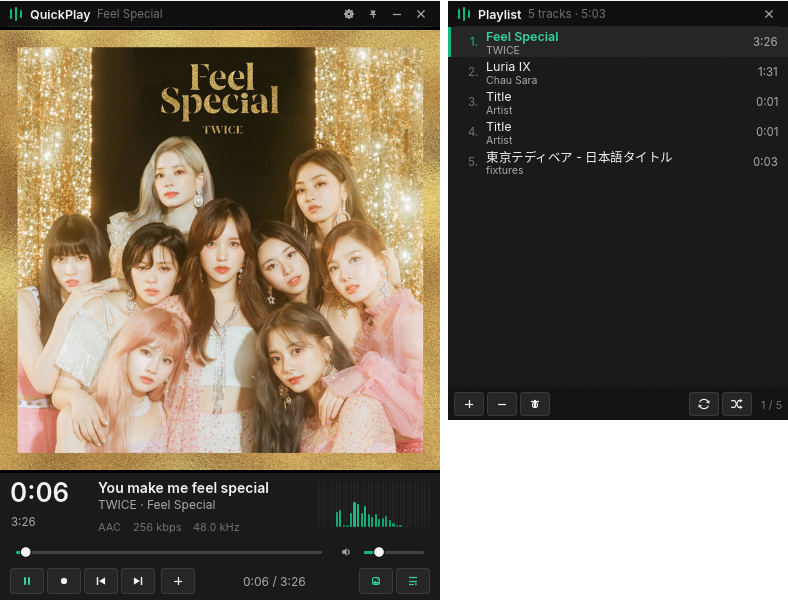
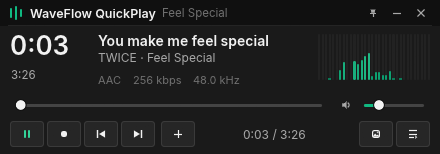
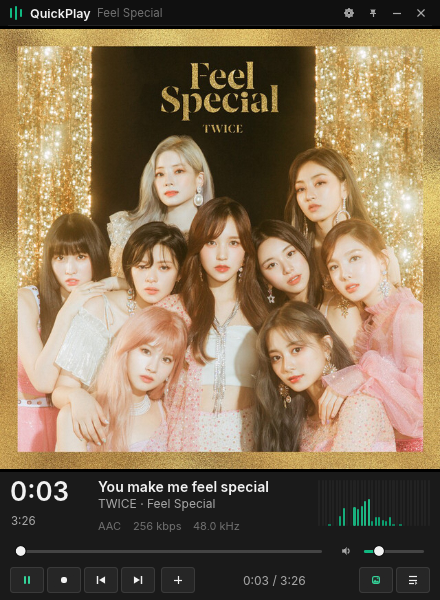
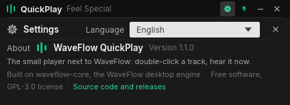

<!-- markdownlint-disable MD033 MD041 -->
<p align="center">
  
</p>

<h1 align="center">WaveFlow QuickPlay</h1>

<p align="center">
  <strong>Double-click. Just listen.</strong>
  <br />
  A small, fast, native music player for Windows and Linux — powered by WaveFlow.
</p>

<p align="center">
  
  
  
  
</p>

<p align="center">
  Sometimes you just want to play a song. No library to manage, no account to create, no waiting for a collection to load.
  <br />
  QuickPlay opens your audio files in a compact player: FLAC, Opus, DSD and the rest, synced lyrics, album artwork, a playlist. From the file manager's right-click menu or a double-click, with the window up in under 300 ms.
  <br />
  <strong>Your files. Your music. Nothing in the way.</strong>
</p>

<p align="center">
  <a href="https://github.com/InstaZDLL/waveflow-quickplay/releases/latest"></a>
</p>

<p align="center">
  <!-- Inverted on purpose: the dark capsule stands out on GitHub's light theme and the light one on its dark theme. -->
  <a href="https://waveflow.app"><picture><source media="(prefers-color-scheme: dark)" srcset="https://raw.githubusercontent.com/InstaZDLL/waveflow-quickplay/main/docs/branding/part-of-waveflow-light.svg" /></picture></a>
</p>

<p align="center">
  <a href="#install"><b>Install</b></a>
  &nbsp;·&nbsp;
  <a href="#features"><b>Features</b></a>
  &nbsp;·&nbsp;
  <a href="#screenshots"><b>Screenshots</b></a>
  &nbsp;·&nbsp;
  <a href="#keyboard"><b>Keyboard</b></a>
  &nbsp;·&nbsp;
  <a href="#build-and-test"><b>Build</b></a>
  &nbsp;·&nbsp;
  <a href="docs/ARCHITECTURE.md"><b>Architecture</b></a>
</p>

<p align="center">
  
  <br />
  <sub><b>Artwork mode</b> · synced lyric in place of the title, spectrum, and the playlist docked beside the player</sub>
</p>

---

## Install

Download the package for your system from the [latest release](https://github.com/InstaZDLL/waveflow-quickplay/releases/latest):

- **Windows**: `waveflow-quickplay_<version>_x64-setup.exe`. A per-user installer, no administrator rights, that also adds *Play with WaveFlow QuickPlay* and *Add to WaveFlow QuickPlay playlist* to the right-click menu of audio files and folders, and removes them on uninstall. It is signed with WaveFlow's self-signed certificate, so SmartScreen may warn once.
- **Linux**: a `.deb` for Debian / Ubuntu, or an `.AppImage` for any distribution (make it executable and run it). Both come with the desktop entry, so QuickPlay appears in "Open with" for audio files.

Then double-click a track, or right-click it. That is the whole setup.

<details>
<summary>From the command line</summary>

```text
waveflow-quickplay "C:\Music\song.flac"
waveflow-quickplay song1.flac song2.mp3 song3.m4a
waveflow-quickplay "C:\Music\Some Album"      # folders are walked (4 levels)
waveflow-quickplay --enqueue more.flac        # append to the running player's queue
waveflow-quickplay --register                 # file-manager integration, current user
waveflow-quickplay --unregister
```

A hand-copied binary (see [Build and test](#build-and-test)) needs `--register` once, and again if it moves: the registry entries and the `.desktop` file point at the executable's path. The installer does it for you.

</details>

## WaveFlow Desktop or QuickPlay?

<table>
  <tr>
    <td width="50%" valign="top">
      <b><a href="https://github.com/InstaZDLL/WaveFlow">WaveFlow Desktop</a></b><br />
      Your complete music experience. Organize, discover, customize and enjoy your entire library: EQ, crossfade, gapless, ReplayGain, device selection, exclusive output.
    </td>
    <td width="50%" valign="top">
      <b>WaveFlow QuickPlay</b><br />
      Just want to play a file? Open it and listen. No library, no setup, no distractions. Same decoders as the desktop app, in a window the size of a notification.
    </td>
  </tr>
</table>

They are complementary, not two sizes of the same thing: QuickPlay deliberately leaves the listening features to the desktop app and does one job, playing the file in front of you.

## Features

### 🎧 Playback

- **Every format WaveFlow plays**: MP3, FLAC, WAV, AIFF, Vorbis, Opus, AAC, ALAC, DSF and DFF, with the desktop app's own decoders.
- **Files and folders** from the command line, a drop on either window or the open dialog; folders are walked four levels deep without blocking the window.
- **Instant pause, clean seeks**, no clicks or pops: the audio thread never waits on the interface.
- **Auto-advance** with the track's tail played out; broken files are skipped and flagged in the playlist.
- **Spectrum** timed to the output clock, so the bars follow what you hear.

### 🖼️ Two sizes, one window

- **Compact**: clock, title, format, seek, volume and transport in 440 × 154 points. Height locked, width free.
- **Artwork**: the cover above the controls, edge to edge, freely resizable. Press `A` or the artwork button to switch.
- Custom title bar with settings, pin (always on top), minimize and close; window size and mode are remembered.

### 📋 Playlist

- A second window beside the player, fast with long queues, showing number, title, artist and duration, the current row in the accent colour and failed rows flagged.
- **Docked**: it follows the player when it moves or widens (drag the playlist to change where it sits), minimizes and restores with it, and shares its taskbar button.
- Double-click to play, right-click for Play / Remove, `Delete` to remove, add / remove / clear in the toolbar.

### 🎤 Lyrics

- A `song.lrc` next to `song.flac` is read when the track starts; the current line replaces the title as the song plays, and an empty line, or the lead-in, shows the title again, as PotPlayer does.
- `[offset:]` and enhanced-LRC word stamps are honoured; nothing is fetched from the network.
- A title or lyric line wider than its column holds for a moment, then scrolls across and comes round again.

### 🖱️ From the file manager

- **One instance**: a second launch hands its files to the open player and exits. Plain launch replaces the queue and plays, `--enqueue` appends; a multi-selection that Explorer starts as one process per file is merged.
- `--register` adds *Play with WaveFlow QuickPlay* and *Add to WaveFlow QuickPlay playlist* to the context menu of every audio extension and of folders, plus an "Open with" entry, for the current user and without administrator rights. On Linux it writes a `.desktop` entry with the audio MIME types. `--unregister` removes it all.
- The default handler for the extensions is left to you (Settings › Default apps, or `xdg-mime default app.waveflow.quickplay.desktop audio/flac`).

### ⚙️ Settings and languages

- The gear in the title bar opens a page in place of the controls: the interface language, and an about block with the version, the licence and the link to this repository. `Esc` or its close button brings the controls back.
- **Eight languages**: English, French, German, Spanish, Italian, Simplified Chinese, Japanese and Korean. The system language is followed by default; a choice is kept in the settings file.
- The file-manager entries follow the interface language: on Windows, picking another language rewrites the context-menu labels of the registered QuickPlay; the Linux desktop entry carries all eight and the desktop picks.

### ✨ And also

- Inter and Noto Sans CJK are embedded: Japanese, Korean and Chinese titles, and the interface in those languages, render the same on every machine.
- Preferences live in their own file, `<config dir>/waveflow-quickplay/settings.json`, never read by the desktop app.
- `RUST_LOG=debug` turns the log up; `QUICKPLAY_CAPTURE_DIR=<dir>` writes a PNG of the player window after start, for displays that cannot be grabbed from outside such as GNOME on Wayland.

## Screenshots

<table>
  <tr>
    <td width="50%" align="center" valign="top"></td>
    <td width="50%" align="center" valign="top"></td>
  </tr>
  <tr>
    <td align="center"><sub><b>Compact</b> · the whole player in 440 × 154</sub></td>
    <td align="center"><sub><b>Artwork</b> · the cover edge to edge, window freely resizable</sub></td>
  </tr>
  <tr>
    <td colspan="2" align="center" valign="top"></td>
  </tr>
  <tr>
    <td colspan="2" align="center"><sub><b>Settings</b> · language and about, in the same 154 points</sub></td>
  </tr>
</table>

## Keyboard

| Key                 | Action                      |
| ------------------- | --------------------------- |
| Space               | Play / pause                |
| N / P               | Next / previous             |
| ← / → (Shift: 30 s) | Seek ±5 s                   |
| ↑ / ↓               | Volume ±5 %                 |
| A                   | Show / hide the artwork     |
| L                   | Show / hide the playlist    |
| S (or click it)     | Show / hide the spectrum    |
| T                   | Always on top               |
| Ctrl+O              | Open files                  |
| Delete (playlist)   | Remove the selected track   |
| Esc                 | Close the settings page     |

Shortcuts work whichever of the two windows has focus.

## Build and test

Requirements: Rust 1.98 (pinned by `rust-toolchain.toml`) and cmake (for
the vendored libopus that `waveflow-core` builds, as the desktop app does).
`waveflow-core` is fetched from the WaveFlow commit pinned in `Cargo.toml`; to
build against a local checkout instead, pass
`--config 'patch."https://github.com/InstaZDLL/WaveFlow".waveflow-core.path="../WaveFlow/src-tauri/crates/core"'`.
On Linux add the ALSA, xkbcommon and Wayland development packages; on macOS
the Xcode command line tools.

```bash
cargo run --release -- <files or folders>
cargo build --release          # → target/release/waveflow-quickplay(.exe)

cargo fmt --check
cargo clippy --all-targets
cargo test

cargo install cargo-packager
cargo packager --release --formats nsis          # Windows: per-user installer
cargo packager --release --formats deb,appimage  # Linux
```

The installers come out in `target/packager/`. The NSIS template in
`packaging/installer.nsi` is cargo-packager's with the `--register` /
`--unregister` steps added; `packaging/quickplay.desktop` is the Linux
desktop entry. Releases are built by `.github/workflows/release.yml` from a
`v*` tag whose notes live in `docs/releases/`.

## Architecture

QuickPlay is Rust + egui, under 8 000 lines including the language tables,
on top of `waveflow-core`, the crate that holds WaveFlow's codec registry
(symphonia + libopus), DSD converter and tag reader. The desktop engine
itself is tied to Tauri, so QuickPlay carries a small playback pipeline of
its own with the same topology: a decoder thread feeding a lock-free ring
that the audio callback drains, state shared through atomics, the output
position as the one clock.

```text
UI thread (egui)  ──AudioCmd──►  decoder thread  ──f32 ring──►  audio callback
                  ◄──events──    symphonia / DSD → channels → resampler
```

The playlist is a second native window the player owns and docks; a local
socket makes the app single-instance; `--register` writes the file-manager
entries. [docs/ARCHITECTURE.md](docs/ARCHITECTURE.md) has the module map,
the pipeline invariants, the window docking per platform and the IPC
protocol.

## Measurements

Windows 11, release profile (`opt-level = 3`, thin LTO, stripped), 2026-10-18,
playing a 48 kHz AAC file resampled to a 44.1 kHz 7.1 output. "First frame"
is the window being drawn; the audio engine opens on the first play, right
after. No comparison with the Tauri desktop app was made, so no claim is
made about it.

| Metric                                   | Value   | How                                                        |
| ---------------------------------------- | ------- | ---------------------------------------------------------- |
| Process start → first frame              | 276 ms  | `window ready elapsed_ms=…` in the log (Instant at main)    |
| Working set, playing with cover shown    | 88 MB   | `Get-Process` WorkingSet64 / PrivateMemorySize64 (85 MB)   |
| CPU while playing, spectrum hidden       | 3.8 %   | TotalProcessorTime delta over 10 s, one core = 100 %        |
| CPU while playing, spectrum shown        | 11.4 %  | same; the visualizer repaints the window at ~30 Hz          |
| CPU while paused                         | 0.0 %   | same, egui repaints only on input                           |
| Release binary                           | 30.7 MB | `target/release/waveflow-quickplay.exe` (16.4 MB of it is the embedded Noto Sans CJK, 0.8 MB Inter) |

Fedora 44, GNOME 50.5 on Wayland (also run under XWayland), same build
profile, same file, stereo 44.1 kHz output, 2026-10-18:

| Metric                                   | Value   | How                                                        |
| ---------------------------------------- | ------- | ---------------------------------------------------------- |
| Process start → first frame              | 62 ms   | `window ready elapsed_ms=…` (66 ms under XWayland)          |
| Resident set, playing with cover shown   | 92 MB   | `/proc/<pid>/status` RSS (96 MB under XWayland)             |
| CPU while playing, spectrum shown        | 6.8 %   | utime+stime delta over 10 s, one core = 100 %               |
| Release binary                           | 33.1 MB | `target/release/waveflow-quickplay`                         |
| Clean release build                      | 2 min 42 s | 8 cores, cmake + libopus included                        |

macOS 26.6 on an Apple M2 (MacBook Air), same build profile, same file,
stereo 48 kHz output on the built-in speakers, bare binary launched from a
shell, 2026-10-18:

| Metric                                   | Value   | How                                                        |
| ---------------------------------------- | ------- | ---------------------------------------------------------- |
| Process start → first frame              | 216 ms  | `window ready elapsed_ms=…` (581 ms on the very first launch) |
| Resident set, playing, compact bar       | 116 MB  | `ps -o rss` (counts shared AppKit/Metal pages too)          |
| CPU while playing, spectrum shown        | 14.5 %  | `top -l 3 -s 5`, one core = 100 %, Retina 2× window         |
| Release binary                           | 28.4 MB | `target/release/waveflow-quickplay`                         |
| Clean release build                      | 1 min 55 s | 8 cores, cmake + libopus included                        |

Verified there: rendering identical to Windows, Opus / AAC / FLAC playback,
the single-instance hand-over over the Unix socket, `--register` showing up
in "Open with", and under XWayland the playlist following the player.

The working set is dominated by the OpenGL driver and the decoded cover
(up to 1024² RGBA); the audio threads themselves are small.

## Known limitations

- **macOS** runs from the bare binary (checked on macOS 26 / Apple silicon:
  playback, the docked playlist, minimize and restore from the Dock, the
  single instance). There is no `.app` bundle or installer yet, and file
  associations there need one; `--register` says so and does nothing.
- **Wayland** does not let an application position its windows, so the
  playlist opens where the compositor puts it and does not follow the
  player there. Under XWayland and everywhere else it docks.
- **Output device**: the OS default, opened at its default configuration
  (shared mode). No device picker, no exclusive mode. If the device goes
  away, the engine is released and the next play reopens the new default.
- **Fonts**: Inter and Noto Sans CJK are embedded; a system face is
  appended as a last fallback for anything else. The CJK file is 16 MB of
  the binary.
- One copy of the pipeline per application. If the prototype is adopted,
  the next step is a Tauri-free `waveflow-audio` crate with an event-sink
  trait, which both the desktop engine and QuickPlay would consume.

## Bundled assets

| File | Author | Source | License |
| --- | --- | --- | --- |
| `assets/fonts/Inter-Regular.ttf`, `Inter-SemiBold.ttf` | The Inter Project Authors | https://github.com/rsms/inter | OFL-1.1 (`assets/fonts/OFL-Inter.txt`) |
| `assets/fonts/NotoSansCJKsc-Regular.otf` | Google, Adobe (Noto CJK) | https://github.com/notofonts/noto-cjk | OFL-1.1 (`assets/fonts/OFL-NotoSansCJK.txt`) |
| `assets/icon-128.png`, `assets/icon.ico` | WaveFlow | `src-tauri/crates/app/icons/` | GPL-3.0-only (project) |
| `docs/branding/part-of-waveflow-*.svg` | WaveFlow | WaveFlow brand assets | WaveFlow ecosystem badge, for official WaveFlow products |

The screenshots show *Feel Special* by TWICE, used for illustration only.

## License

```
Copyright (C) 2026 InstaZDLL

This program is free software: you can redistribute it and/or modify
it under the terms of the GNU General Public License as published by
the Free Software Foundation, either version 3 of the License, or
(at your option) any later version.

This program is distributed in the hope that it will be useful,
but WITHOUT ANY WARRANTY; without even the implied warranty of
MERCHANTABILITY or FITNESS FOR A PARTICULAR PURPOSE. See the
GNU General Public License for more details.

You should have received a copy of the GNU General Public License
along with this program. If not, see <https://www.gnu.org/licenses/>.
```

See [LICENSE](LICENSE) for the full text.
